  
  
  

  

<b>Read this page as text</b>

# Code of Conduct

This project adopts the [Contributor Covenant, version 2.1](https://www.contributor-covenant.org/version/2/1/code_of_conduct/).

## Our pledge

We pledge to make participation in our community a harassment-free experience for everyone, regardless of age, body size, visible or invisible disability, ethnicity, sex characteristics, gender identity and expression, level of experience, education, socio-economic status, nationality, personal appearance, race, religion, or sexual identity and orientation.

## Our standards

Examples of behavior that contributes to a positive environment:

- Being respectful of differing opinions, viewpoints and experiences
- Giving and gracefully accepting constructive feedback
- Focusing on what is best for the community

Examples of unacceptable behavior:

- Harassment, insults or derogatory comments
- Publishing others' private information without explicit permission
- Other conduct which could reasonably be considered inappropriate in a professional setting

## Enforcement

Instances of abusive, harassing or otherwise unacceptable behavior may be reported to the maintainers at **keylorpineda729@gmail.com**. All complaints will be reviewed and investigated promptly and fairly, following the enforcement guidelines of the Contributor Covenant.

