<a href="COSTA_RICA.md">English</a> | <b>Español</b>

  
  

  

<b>Leer esta página como texto</b>

## La situación en Costa Rica

Por qué un simulador de finanzas personales en Costa Rica, con las cifras detrás de cada decisión del
juego. Cada número enlaza a donde se publicó. La mayoría llega por la prensa nacional que cita a la
institución original, y lo decimos. Consultado el 2 de noviembre de 2026.

### La deuda es lo normal

La Oficina del Consumidor Financiero (OCF) encuestó por teléfono a 1 200 personas de 18 a 70 años en
julio de 2025, en representación de unos 3,6 millones de adultos, con un margen de error de 2,8%. [^ocf]

| Cifra | Qué mide |
| --- | --- |
| **87%** | Tiene algún tipo de deuda (91% en 2023). Cuenta cualquier deuda, así que el dato fuerte es el siguiente |
| **34%** | Del ingreso mensual va a pagar deudas, en promedio (38% en 2023, 52% en 2020) |
| **58,3%** | Esa misma parte para quienes ganan menos de ₡500 000 al mes |
| **14,7%** | Esa misma parte de los 18 a los 24 años, muy por debajo del promedio |
| **Cerca de 1 de cada 3** | Hogares tiene meses en que la plata llega tarde y le toca pedir prestado |

Nuestra lectura del 14,7%: los jóvenes todavía no se han llenado de deudas, y ese es el momento de
practicar. Por eso el jugador de ColonQuest tiene 18 años y empieza con su primer trabajo.

### Nadie lo enseña

| Cifra | Qué mide |
| --- | --- |
| **80,88%** | De los encuestados nunca recibió educación financiera |
| **73,89%** | Dice que al menos un curso le sería útil |

Encuesta del CINPE y el IDESPO de la Universidad Nacional, 1 705 personas de 18 años o más, publicada en
abril de 2024. [^cinpe] La Ley 10627, para promover la educación financiera, rige desde el 18 de febrero
de 2025 y se reglamentó el 11 de febrero de 2026, [^law] así que el país ya está pidiendo justo esto.

### Las trampas del juego son reales

**Gota a gota.** Prestamistas que piden poco más que la cédula y cobran a diario.

| Cifra | Qué mide | Fuente |
| --- | --- | --- |
| **2 930** | Casos vinculados al gota a gota en 2025, en todo el país | OIJ, conferencia de prensa [^oij] |
| **2 050** | Casos en lo que va de 2026, a agosto | OIJ, conferencia de prensa [^oij] |
| **20% a 100%** | Interés encontrado en estos préstamos | OIJ [^oij] |
| **₡5 000 a ₡15 000** | Pago diario de algunos deudores | OIJ [^oij] |
| **3%, unas 92 000 personas** | Tomó un gota a gota en los últimos tres años (12% en 2023) | OCF [^informal] |
| **50 000 a 66 000** | Personas que tienen uno ahora mismo | OCF [^informal] |
| **14%** | Recibió ofertas de préstamo por WhatsApp, Facebook o TikTok en el último año | OCF [^informal] |

Las fuentes no coinciden, y no lo escondemos. Otro conteo del OIJ da 1 662 denuncias entre 2025 y 2026,
653 de ellas en 2026, [^teletica] contra los 2 930 y 2 050 casos de arriba, probablemente porque cuentan
cosas distintas. Y la encuesta muestra que el gota a gota baja mientras suben los casos policiales. Usamos
la cifra del OIJ en su propia conferencia, como cantidad de casos y no de víctimas.

**La tarjeta y el pago mínimo.** El Banco Central fija un máximo legal cada seis meses: **36,48% anual** en
colones para el segundo semestre de 2026, y las tarjetas entran ahí. Los microcréditos tienen su propio
tope de 51,51%. [^usury] El 18% dice financiar compras con tarjeta. [^ocf]

**Cuotas.** El 22% menciona deudas con tiendas de electrodomésticos, cooperativas y asociaciones
solidaristas. [^ocf] Es la deuda que ofrecen los vendedores del juego: una cuota pequeña y un seguro por el
que nadie preguntó.

**Pirámides.** En 2021 la Sugef trasladó a la Fiscalía al menos 50 denuncias por aparentes estafas en
pirámides. [^sugef] En agosto de 2025 la Fiscalía investigaba un esquema en Costa Rica, Panamá y México,
donde los afectados creen que hay más de 600 inversionistas. [^fiscalia]

### El motor usa las reglas reales

La IA cuenta la historia; estos son los números con los que calcula el motor.

| En el juego | La regla real | Fuente |
| --- | --- | --- |
| Salario bruto ₡373 092 | Salario mínimo de un trabajador no calificado en 2026, ₡373 092,30 al mes | Decreto 45303-MTSS, [^wage] y `GameRules.cs` |
| 10,83% rebajado del salario | Cargas del trabajador en 2026: SEM 5,50, IVM 4,33, Banco Popular 1,00 | Revisado en [el análisis del motor](docs/ANALISIS_RUBRICA_README_MOTOR.md) |
| Renta exenta hasta ₡918 000 | Tramos 2026: 10%, 15%, 20% y 25% de ahí para arriba | Decreto 45333-H, mismo análisis |
| Aguinaldo de un doceavo | Exento de cargas y de renta | Ley 2412, mismo análisis |
| Tarjeta al 3% mensual | 36% anual, bajo el tope de 36,48% | [^usury] |
| Prestamista al 20% mensual | Lo más bajo de lo que halló el OIJ | [^oij] |

Simplificaciones que elegimos: la renta no tiene créditos por hijos ni cónyuge, y los precios del pueblo son
ejemplos, como dice el propio juego.

### Qué hace el juego con esto

| Lo que pasa en Costa Rica | Lo que practica el jugador |
| --- | --- |
| Un tercio del ingreso se va en deudas | Vivir mes a mes con el salario real, con el cierre real de cada mes |
| Cuotas con costos que nadie menciona | Preguntarle al vendedor el total, el seguro y la comisión, en voz alta |
| Pagar solo el mínimo | Ver crecer el saldo con la tasa real |
| Un prestamista a un mensaje de distancia | Preguntar cuánto cuesta, y conocer a los cobradores si firma |
| Un amigo con un negocio seguro | Preguntar de dónde sale la plata antes de meter la suya |

**Lo que todavía no podemos afirmar:** que funciona. No tenemos resultados de un piloto para publicar, así
que esta página describe el problema y el diseño, no un efecto. El Modo Clase y la telemetría por decisión
están ahí para medirlo, y los resultados irán en `docs/pilot/`.

### Fuentes

[^ocf]: OCF, Encuesta Nacional de Endeudamiento 2025, en [Delfino.cr, 22 de octubre de 2025](https://delfino.cr/2025/10/aunque-los-costarricenses-comprometen-en-promedio-menos-dinero-para-el-pago-de-deudas-el-nivel-de-endeudamiento-es-alto-para-buena-parte-de-la-poblacion).
[^informal]: OCF, misma encuesta, en [Delfino.cr, 4 de noviembre de 2025](https://delfino.cr/2025/11/ocf-advierte-que-el-credito-informal-sigue-afectando-a-los-sectores-con-menos-ingresos-en-costa-rica).
[^cinpe]: CINPE e IDESPO (UNA), en [El Financiero, 8 de abril de 2024](https://www.elfinancierocr.com/economia-y-politica/una-cartera-muy-estrecha-menos-del-10-de-las/22FABMYC6ZE47JR73C2UYYMBJU/story).
[^law]: Fechas de la Ley 10627, de una columna de opinión en [La Nación, 20 de mayo de 2026](https://www.nacion.com/opinion/foros/entre-la-tarjeta-y-la-loteria-tenemos-cultura/LRYCPI4W65HN3IG2EQ256KSCPU/story/).
[^oij]: OIJ, conferencia de prensa, en [Semanario Universidad, 11 de agosto de 2026](https://semanariouniversidad.com/pais/oij-registra-mas-de-2-000-casos-vinculados-a-prestamos-gota-a-gota-en-lo-que-va-de-2026/).
[^teletica]: OIJ, en [Teletica, 21 de agosto de 2026](https://www.teletica.com/nacional/prestamos-gota-a-gota-acumulan-mas-de-1600-denuncias-en-menos-de-dos-anos_415829).
[^usury]: BCCR, en [Delfino.cr, julio de 2026](https://www.delfino.cr/2026/07/topes-de-usura-tendran-ajustes-mixtos-para-el-segundo-semestre).
[^sugef]: [Teletica, 29 de junio de 2021](https://www.teletica.com/288694_sugef-traslada-a-fiscalia-50-denuncias-por-aparentes-estafas-en-piramides).
[^fiscalia]: [CRHoy, 26 de agosto de 2025](https://crhoy.com/fiscalia-investiga-multimillonario-fraude-con-esquema-piramidal-en-tres-paises/).
[^wage]: Decreto 45303-MTSS, con el aumento de 1,63% desde el 1 de enero de 2026, en [KPMG Costa Rica](https://kpmg.com/cr/es/insights/2025/11/newsflash-nov-7-2025.html) y [Bloomberg Línea](https://www.bloomberglinea.com/latinoamerica/costa-rica/salario-minimo-2026-en-costa-rica-nuevos-montos-para-el-sector-privado/).

