<p align="center"><a href="README.md">English</a> | <b>Español</b></p>

<p align="center">
  
</p>

<details>
<summary><b>Leer esta página como texto</b></summary>

## Colón Quest

De Costa Rica para el mundo. Un juego 2D de educación financiera para estudiantes de Costa Rica,
hecho por DoWhile Team para el Meta Global AI Developer Hackathon 2026 (track Indie). Cada
decisión de plata se vuelve una historia: vos decidís, Muse Wonder narra, el motor en C# calcula
los colones exactos y negociás con la voz. La IA cuenta la historia; el motor lleva las cuentas.

### El problema

Muchos jóvenes costarricenses toman sus primeras decisiones grandes de plata solos, y la primera
lección real suele ser la deuda misma. Nadie te enseña a hacer la pregunta correcta mientras un
vendedor te sonríe. Esa es la habilidad que entrena Colón Quest. El juego enseña a detectar
cuatro trampas:

- **Cuotas:** solo una cuota al mes, y un seguro escondido.
- **Pago mínimo:** pagás poquito y la deuda sigue creciendo.
- **Gota a gota:** plata rápida hoy, intereses cada semana.
- **Pirámide:** traé tres amigos y te hacés rico. Seguro.

### Cómo se juega un mes

Te llega el salario con el rebajo de la CCSS y la renta. Decidís qué pagar, ahorrar o pedir
prestado. Muse Wonder escribe un evento hecho para tu situación y el motor en C# lo aplica en
colones enteros. Cuando aparece un vendedor, negociás en voz alta: el precio, la tasa, el seguro y
la comisión reales solo salen si preguntás.

### Criterios del jurado

| Criterio | Peso | Qué construimos |
| --- | --- | --- |
| Impacto | 30% | Telemetría por decisión, Modo Clase para profesores y una prueba piloto |
| Herramientas de Meta | 25% | Cuatro modelos de Meta con un rol claro cada uno, más agentes con herramientas |
| Demo | 25% | Un solo link; cada llamada a un modelo tiene tiempo límite y respaldo |
| Profundidad técnica | 20% | Contratos validados, un motor exacto y más de 260 tests en CI |

### Modelos de Meta

| Modelo | Rol |
| --- | --- |
| Muse Wonder | Game master y la voz de los personajes |
| Muse Spark | Plan de temporada, resumen del año y reportes del Modo Clase |
| Muse Voice Transcribe | Negociás en voz alta; escribir siempre sirve |
| Muse Image | Retratos en pixel art, pre-generados y en caché |

### Agentes

Detrás de banderas de configuración, ver [ADR 0003](docs/adr/0003-agentic-game-master.md) (en
inglés).

- **Game master:** usa herramientas de solo lectura como `simulate_purchase` y `project_debt`, así
  las consecuencias que narra usan números reales.
- **Planificador:** arma el recorrido del año y repasa los conceptos en los que el jugador falló.
- **Vendedor:** empuja plazos más largos para ganar más comisión, pero solo puede decir cifras de
  su ficha oculta o de sus herramientas.

### Arquitectura

Un cliente Unity 2D (WebGL y escritorio, motor financiero en C#) se comunica por JSON con un
backend FastAPI (contratos Pydantic v2, control de costos, agentes). El backend llama a la API de
modelos de Meta, guarda sesiones y decisiones en Neon Postgres y puede correr los personajes en
modelos abiertos en Baseten o Modal.

- Ningún monto, tasa ni saldo sale de un modelo.
- La plata es un número entero de colones.
- Toda respuesta de un modelo se valida y tiene respaldo.
- Toda llamada pasa por un control de costos diario.
- Las llaves de API viven solo en el backend.

### Accesibilidad

| Área | Estado | Qué significa |
| --- | --- | --- |
| Voz opcional | Listo | Cada turno de negociación acepta texto |
| Lenguaje claro | Listo | Narraciones cortas en español tico cotidiano |
| Sin bloqueos | Listo | Si un modelo falla, entra contenido escrito a mano |
| Página legible | Listo | Esta versión en texto, y la tarjeta se queda quieta si se pide menos movimiento |
| Teclado | En progreso | Movimiento y paneles sin usar el mouse |
| No solo color | En progreso | Cada color lleva también una etiqueta o un ícono |
| Texto ajustable | Pendiente | Letra más grande en paneles y diálogos |

### Correrlo local

Necesitás [uv](https://docs.astral.sh/uv/). Copiá `.env.example` a `.env` y llenalo con tus
propios valores; nunca lo subas al repositorio.

```bash
cd server
cp .env.example .env
uv sync
uv run alembic upgrade head
uv run uvicorn app.main:app --reload
```

En Windows, levantá el servidor con `uv run python -m app.dev`. Para correr las pruebas:

```bash
uv run pytest
```

El trabajo se registra en Jira (proyecto `SCRUM`); leé [CONTRIBUTING.md](CONTRIBUTING.md) y
[SECURITY.md](SECURITY.md). La tarjeta de arriba se genera con `python scripts/build_readme_art.py`.

### Equipo

DoWhile Team: Keylor Pineda y Jefferson, hecho en equipo para el Meta Global AI Developer
Hackathon 2026. Publicado bajo la [licencia MIT](LICENSE).

</details>
