<p align="center"><a href="README.md">English</a> | <b>Español</b></p>

<p align="center">
  
</p>

<p align="center">
  <a href="https://github.com/keylorpineda/ColonQuest/actions/workflows/ci.yml"></a>
  <a href="LICENSE"></a>
  
  
  
</p>

<p align="center">
  <b>Un juego 2D de educación financiera para estudiantes de Costa Rica.</b><br>
  Viví un año de las finanzas de una persona joven, en español tico, con un game master de IA<br>
  y personajes que intentan engañarte. Hecho por DoWhile Team para el
  <b>Meta Global AI Developer Hackathon 2026</b> (track Indie).
</p>

<h2></h2>

Muchos jóvenes costarricenses toman sus primeras decisiones grandes de plata solos, y la primera
lección real suele ser la deuda misma. En el cole se aprende la teoría; nadie te enseña a **hacer
la pregunta correcta mientras un vendedor te sonríe**. Esa es la habilidad que entrena Colón Quest.

<p align="center">
  
</p>

**Cómo se juega un mes.** Te llega el salario con el rebajo de la CCSS y del impuesto de renta.
Decidís qué pagar, ahorrar o pedir prestado. Muse Wonder escribe un evento hecho para tu situación:
una tarjeta al límite atrae a un prestamista, un buen ahorro atrae una "oportunidad de negocio" y
diciembre trae aguinaldo y marchamo. El motor en C# lo aplica en colones enteros. Cuando aparece un
vendedor, negociás en voz alta. El vendedor tiene una ficha oculta con el precio de contado, la
tasa, el seguro y la comisión reales, y solo revela cada cifra si se la preguntás.

<h2></h2>

<p align="center">
  
</p>

| Criterio | Qué construimos |
| --- | --- |
| **Impacto** | Cada decisión y negociación se guarda: concepto enseñado, opción riesgosa elegida, trampa detectada y deuda al cierre del año. El **Modo Clase** le da al profesor un código corto y un panel con esas métricas por concepto, calculadas en SQL. La prueba piloto con estudiantes es el 1 de noviembre. |
| **Herramientas de Meta** | Cuatro modelos de Meta, cada uno con un rol claro, más un game master y un vendedor con agentes que usan herramientas. No es un chatbot genérico. |
| **Demo** | Un build WebGL en un solo link. Cada llamada a un modelo tiene tiempo límite y un respaldo escrito a mano, y la voz siempre tiene texto de respaldo, así que el juego no se cae en vivo. |
| **Profundidad técnica** | Contratos Pydantic exportados a `shared/`, un motor financiero con tests de EditMode, control de costos con presupuesto diario y más de 260 tests del backend en CI contra PostgreSQL. |

<h2></h2>

<p align="center">
  
</p>

**Agentes, detrás de banderas** ([ADR 0003](docs/adr/0003-agentic-game-master.md), en inglés):

- El **game master** usa herramientas de solo lectura (`simulate_purchase`, `project_debt`,
  historial del jugador) antes de escribir, así las consecuencias que narra usan números reales.
- El **planificador de temporada** arma el recorrido del año y repasa los conceptos en los que el
  jugador falló.
- El **vendedor** es un agente que empuja plazos más largos para ganar más comisión. Puede callar
  cifras, pero solo puede decir montos de su ficha oculta o de sus propias herramientas.

<h2></h2>

<p align="center">
  
</p>

| Regla que el código no rompe | Por qué |
| --- | --- |
| La IA cuenta la historia; el motor lleva las cuentas | Ningún monto, tasa ni saldo sale de un modelo de lenguaje |
| La plata es un número entero de colones | Sin errores de redondeo, sin decimales para montos |
| Toda respuesta de un modelo se valida | Un reintento y después un respaldo escrito a mano |
| Toda llamada a un modelo pasa por el control de costos | Spark al 80% del presupuesto diario, solo respaldos al 100% |
| Las llaves de API viven solo en el backend | Nunca en Unity, nunca en el repositorio |

<h2></h2>

| Área | Estado | Qué significa |
| --- | --- | --- |
| La voz es opcional | Listo | Cada turno de negociación acepta texto escrito; el micrófono nunca es obligatorio. |
| Lenguaje claro | Listo | Las narraciones tienen menos de 280 caracteres, en español tico cotidiano, y los montos siempre se escriben igual (₡85 000). |
| Sin callejones sin salida | Listo | Si un modelo falla, tarda o se acaba el presupuesto, el juego usa contenido escrito a mano y nadie se queda esperando. |
| Documentación legible | Listo | Cada imagen de este repositorio tiene texto alternativo, y las animaciones se detienen si el sistema pide reducir el movimiento. |
| Jugar con teclado | En progreso | Movimiento y todos los paneles usables sin mouse. |
| No solo por color | En progreso | Ganancias, deudas y alertas llevan una etiqueta o un ícono además del color. |
| Texto ajustable | Pendiente | Opción de letra más grande en paneles y diálogos. |

Si algo del juego o de este repositorio es difícil de usar, abrí un issue.

<h2></h2>

Necesitás [uv](https://docs.astral.sh/uv/), que instala Python 3.12 por vos.

```bash
cd server
cp .env.example .env
uv sync
uv run alembic upgrade head
```

Llená `.env` con tus propios valores y nunca lo subas al repositorio. Después levantá el servidor:

```bash
uv run uvicorn app.main:app --reload
```

En Windows usá `uv run python -m app.dev`, porque psycopg asíncrono necesita un event loop de tipo
selector. Abrí <http://localhost:8000/docs> para ver la documentación interactiva de la API.

```bash
uv run pytest
```

```bash
uv run ruff check . && uv run mypy app
```

<h2></h2>

| Carpeta | Responsable | Contenido |
| --- | --- | --- |
| [`server/`](server/) | Keylor | App FastAPI, proveedores de modelos, agentes, control de costos, migraciones y tests |
| [`unity/`](unity/) | Jefferson | Proyecto Unity 2D y el motor financiero en C# |
| [`shared/`](shared/) | Ambos | Esquemas JSON exportados del backend (el contrato de la API) |
| [`scripts/`](scripts/) | Ambos | Pre-generación de imágenes, clases de prueba, smoke test y el arte del README |
| [`docs/`](docs/) | Ambos | Decisiones de arquitectura, despliegue, flujo de trabajo y resultados del piloto |

El trabajo se registra en Jira (proyecto `SCRUM`) y cada rama, commit y pull request se enlaza a un
ticket. `main` tiene las versiones estables; todo el trabajo sale de `develop` y vuelve por pull
request. Leé [CONTRIBUTING.md](CONTRIBUTING.md) antes de abrir uno y [SECURITY.md](SECURITY.md)
para reportar una vulnerabilidad. El arte del README se genera con
`python scripts/build_readme_art.py`.

<h2></h2>

| Integrante | Rol |
| --- | --- |
| **Keylor Pineda** | Backend, integración de IA y motor financiero |
| **Jefferson** | Cliente Unity, arte y flujo del juego |

Publicado bajo la [licencia MIT](LICENSE).

<p align="center">
  
</p>
