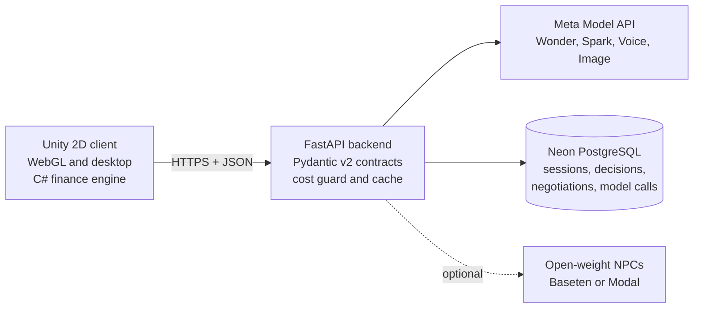

<p align="center">
  
</p>

<p align="center">
  <a href="https://github.com/keylorpineda/ColonQuest/actions/workflows/ci.yml"></a>
  <a href="LICENSE"></a>
  
  
  
</p>

**Colón Quest** is a 2D financial-literacy game for Costa Rican high-school and university
students, built by the DoWhile Team for the **Meta Global AI Developer Hackathon 2026** (Indie
track). You live one year of a young adult's finances: every month an AI game master turns your
situation into an event, and you negotiate out loud with characters who try to trick you.

## The problem

Many young Costa Ricans make their first big money decisions alone: a phone "a cuotas" with
insurance nobody mentioned, a credit card paid at the minimum, a fast loan from a *gota a gota*
lender, a friend's "business" that pays you for bringing more people in. Financial education at
school is mostly theory, so the first real lesson is usually the debt itself.

Worksheets do not teach you to **ask the right question while a salesperson is smiling at you**.
That is the skill Colón Quest trains, in Costa Rican Spanish, with consequences you can feel and
numbers that are exactly right.

## How a month plays

1. **Decide.** Your salary arrives with CCSS and income tax deducted. Pay bills, save, use the
   card, or accept that tempting offer.
2. **Narrate.** Muse Wonder reads your situation and writes one event built for you: a maxed-out
   card attracts a lender, high savings attract a pyramid scheme, December brings aguinaldo and
   marchamo. It shows consequences, never lectures.
3. **Compute.** A deterministic C# engine applies the event in whole colones: card interest,
   minimum payments, installments, informal loans. The model only proposes effects, and the
   backend clamps them to allowed ranges before the engine checks them again.
4. **Negotiate.** Talk to the seller with your voice (or type). The seller holds a hidden sheet
   with the real cash price, rate, insurance and commission, and only reveals each figure if you
   ask for it. The game records which key questions you asked.

At the end of the year Muse Spark writes a short, personal summary from your real numbers.

## How it meets the judging criteria

| Criterion | Weight | What we built |
| --- | --- | --- |
| **Impact** | 30% | Every decision and negotiation is stored as telemetry: concept taught, risky choice taken, trap detected, debt at year end. **Class Mode** gives teachers a short code and a dashboard with those metrics per concept, computed in SQL. A pilot with students runs on Nov 1. |
| **Use of Meta tools** | 25% | Four Meta models, each with one clear job (see the table below), plus an agentic game master and seller that use tool calling. No generic chatbot. |
| **Demo** | 25% | A playable WebGL build behind a single link. The game never breaks because of a model: every call has a timeout and a hand-written fallback, and voice always has a text fallback. |
| **Technical depth** | 20% | JSON contracts validated with Pydantic and exported to `shared/`, a finance engine with EditMode tests, a cost guard with a daily budget, and 260+ backend tests in CI against PostgreSQL. |

### Meta models and their roles

| Model | Role in the game | Guardrail |
| --- | --- | --- |
| Muse Wonder | Game master: the monthly event and the voices of the characters | Schema-validated, amounts clamped, 8 s timeout, fallback events |
| Muse Spark | Year-end summary, season plan, Class Mode explanations; automatic downgrade target | May only quote numbers that come from the data |
| Muse Voice Transcribe | Turns what the player says into text during negotiation | 15 s clips, text input always available |
| Muse Image | Pixel-art portraits and scenes | Pre-generated and cached by key |

**Agentic features** (behind flags, see [ADR 0003](docs/adr/0003-agentic-game-master.md)): the
game master calls read-only tools (`simulate_purchase`, `project_debt`, player history) before
writing; a season planner sets the year's teaching arc and reinforces concepts the player
struggled with; the seller is an agent that pushes longer terms to earn more commission, but can
only quote figures from its sheet or its own tool results.

## Architecture



Rules the code never breaks:

- **The AI tells the story; the finance engine keeps the books.** No amount, rate or balance
  comes from a language model.
- **Money is an integer** number of colones. No floats for amounts.
- **Every model answer is validated** against a schema, retried once, then replaced by a fallback.
- **Every model call goes through the cost guard.** At 80% of the daily budget the game master
  switches to Muse Spark; at 100% it serves only hand-written events.
- **API keys live only in the backend** environment, never in Unity or in the repository.

## Accessibility

Accessibility is part of the design, not a final pass.

| Area | Status | What it means |
| --- | --- | --- |
| Voice is optional | Done | Every negotiation turn accepts typed text; the microphone is never required. |
| Plain language | Done | Narratives are capped at 280 characters, in everyday Costa Rican Spanish, and amounts are always written the same way (₡85 000). |
| No dead ends | Done | Model errors, timeouts and budget limits fall back to scripted content, so a player is never stuck waiting. |
| Readable documentation | Done | Images in this repository have text alternatives, and the animated card stops moving when the system asks for reduced motion. |
| Keyboard play | In progress | Movement and every panel usable without a mouse. |
| Not by color alone | In progress | Gains, debts and warnings carry a label or icon as well as a color. |
| Adjustable text | Planned | Larger font option for panels and dialogue. |

If something in the game or this repository is hard to use, please open an issue.

## Repository layout

| Path | Owner | Contents |
| --- | --- | --- |
| [`server/`](server/) | Keylor | FastAPI app, model providers, agents, cost guard, migrations, tests |
| [`unity/`](unity/) | Jefferson | Unity 2D project and the C# finance engine |
| [`shared/`](shared/) | Both | JSON schemas exported from the backend (the API contract) |
| [`scripts/`](scripts/) | Both | Image pre-generation, test class seeding |
| [`docs/`](docs/) | Both | Architecture decisions, deployment, workflow, pilot results |

## Getting started (backend)

Requires [uv](https://docs.astral.sh/uv/), which installs Python 3.12 for you.

```bash
cd server
cp .env.example .env
uv sync
uv run alembic upgrade head
```

Fill in `.env` with your own values and never commit it. Then start the server:

```bash
uv run uvicorn app.main:app --reload
```

On Windows use `uv run python -m app.dev` instead, because async psycopg needs a selector event
loop. Open <http://localhost:8000/docs> for the interactive API documentation.

```bash
uv run pytest
```

```bash
uv run ruff check . && uv run mypy app
```

## Team

**DoWhile Team**

- **Keylor Pineda**: backend, AI integration and finance engine.
- **Jefferson**: Unity client, art and game flow.

## Contributing

Work is tracked in Jira (project key `SCRUM`) and every branch, commit and pull request links to a
ticket. `main` holds stable releases; all work branches off `develop` and returns to it through
pull requests. Read [CONTRIBUTING.md](CONTRIBUTING.md) before opening one, and see
[SECURITY.md](SECURITY.md) to report a vulnerability.

## License

[MIT](LICENSE)
