<p align="center">
  
</p>

<p align="center">
  <a href="https://github.com/keylorpineda/ColonQuest/actions/workflows/ci.yml"></a>
  <a href="LICENSE"></a>
  
  
  
</p>

<p align="center">
  <b>A 2D financial-literacy game for Costa Rican students.</b><br>
  Live one year of a young adult's finances, in Costa Rican Spanish, with an AI game master<br>
  and characters who try to trick you. Built by the DoWhile Team for the
  <b>Meta Global AI Developer Hackathon 2026</b> (Indie track).
</p>

<h2></h2>

Many young Costa Ricans make their first big money decisions alone, and the first real lesson is
usually the debt itself. School teaches the theory; nobody teaches you to **ask the right
question while a salesperson is smiling at you**. That is the skill Colón Quest trains.

<p align="center">
  
</p>

**How a month plays.** Your salary arrives with CCSS and income tax already deducted. You decide
what to pay, save or borrow. Muse Wonder writes one event built for your situation: a maxed-out
card attracts a lender, high savings attract a "business opportunity", and December brings
aguinaldo and marchamo. The C# engine applies it in whole colones. When a seller appears, you
negotiate out loud. The seller holds a hidden sheet with the real cash price, rate, insurance and
commission, and only reveals each figure if you ask for it.

<h2></h2>

<p align="center">
  
</p>

| Criterion | What we built |
| --- | --- |
| **Impact** | Every decision and negotiation is stored: concept taught, risky choice taken, trap detected, debt at year end. **Class Mode** gives teachers a short code and a dashboard of those metrics per concept, computed in SQL. A pilot with students runs on November 1. |
| **Meta tools** | Four Meta models with one clear job each, plus an agentic game master and seller that use tool calling. No generic chatbot. |
| **Demo** | A WebGL build behind one link. Every model call has a timeout and a hand-written fallback, and voice always has a text fallback, so the game never breaks live. |
| **Technical depth** | Pydantic contracts exported to `shared/`, a finance engine with EditMode tests, a cost guard with a daily budget, and 260+ backend tests in CI against PostgreSQL. |

<h2></h2>

<p align="center">
  
</p>

**Agents, behind flags** ([ADR 0003](docs/adr/0003-agentic-game-master.md)):

- The **game master** calls read-only tools (`simulate_purchase`, `project_debt`, player history)
  before writing, so the consequences it narrates use real numbers.
- The **season planner** sets the year's teaching arc and brings back the concepts a player
  struggled with.
- The **seller** is an agent that pushes longer terms to earn more commission. It can omit
  figures, but it can only quote amounts from its hidden sheet or its own tool results.

<h2></h2>

<p align="center">
  
</p>

| Rule the code never breaks | Why |
| --- | --- |
| The AI tells the story; the engine keeps the books | No amount, rate or balance ever comes from a language model |
| Money is an integer number of colones | No rounding drift, no floats for amounts |
| Every model answer is validated | One retry, then a hand-written fallback |
| Every model call goes through the cost guard | Spark at 80% of the daily budget, fallbacks only at 100% |
| API keys live only in the backend | Never in Unity, never in the repository |

<h2></h2>

| Area | Status | What it means |
| --- | --- | --- |
| Voice is optional | Done | Every negotiation turn accepts typed text; the microphone is never required. |
| Plain language | Done | Narratives stay under 280 characters, in everyday Costa Rican Spanish, and amounts are always written the same way (₡85 000). |
| No dead ends | Done | Model errors, timeouts and budget limits fall back to scripted content, so a player is never stuck waiting. |
| Readable documentation | Done | Every image here has a text alternative, and the animations stop when the system asks for reduced motion. |
| Keyboard play | In progress | Movement and every panel usable without a mouse. |
| Not by color alone | In progress | Gains, debts and warnings carry a label or icon as well as a color. |
| Adjustable text | Planned | Larger font option for panels and dialogue. |

If something in the game or this repository is hard to use, please open an issue.

<h2></h2>

Requires [uv](https://docs.astral.sh/uv/), which installs Python 3.12 for you.

```bash
cd server
cp .env.example .env
uv sync
uv run alembic upgrade head
```

Fill in `.env` with your own values and never commit it. Then start the server:

```bash
uv run uvicorn app.main:app --reload
```

On Windows use `uv run python -m app.dev` instead, because async psycopg needs a selector event
loop. Open <http://localhost:8000/docs> for the interactive API documentation.

```bash
uv run pytest
```

```bash
uv run ruff check . && uv run mypy app
```

<h2></h2>

| Path | Owner | Contents |
| --- | --- | --- |
| [`server/`](server/) | Keylor | FastAPI app, model providers, agents, cost guard, migrations, tests |
| [`unity/`](unity/) | Jefferson | Unity 2D project and the C# finance engine |
| [`shared/`](shared/) | Both | JSON schemas exported from the backend (the API contract) |
| [`scripts/`](scripts/) | Both | Image pre-generation, class seeding, smoke test, README art |
| [`docs/`](docs/) | Both | Architecture decisions, deployment, workflow, pilot results |

Work is tracked in Jira (project `SCRUM`) and every branch, commit and pull request links to a
ticket. `main` holds stable releases; all work branches off `develop` and returns through pull
requests. Read [CONTRIBUTING.md](CONTRIBUTING.md) before opening one and
[SECURITY.md](SECURITY.md) to report a vulnerability. The README art is generated with
`python scripts/build_readme_art.py`.

<h2></h2>

| Member | Role |
| --- | --- |
| **Keylor Pineda** | Backend, AI integration and finance engine |
| **Jefferson** | Unity client, art and game flow |

Released under the [MIT License](LICENSE).

<p align="center">
  
</p>
