<p align="center"><b>English</b> | <a href="README.es.md">Español</a></p>

<p align="center">
  
</p>

<details>
<summary><b>Read this page as text</b></summary>

## Colón Quest

From Costa Rica to the world. A 2D financial-literacy game for Costa Rican students, built by the
DoWhile Team for the Meta Global AI Developer Hackathon 2026 (Indie track). Every money decision
becomes a story: you decide, Muse Wonder narrates, the C# engine computes the exact colones, and
you negotiate by voice. The AI tells the story; the engine keeps the books.

### The problem

Many young Costa Ricans make their first big money decisions alone, and the first real lesson is
usually the debt itself. Nobody teaches you to ask the right question while a salesperson is
smiling at you. That is the skill Colón Quest trains. The game teaches players to spot four traps:

- **Installments:** just one payment a month, plus hidden insurance.
- **Minimum payment:** you pay a little and the debt keeps growing.
- **Gota a gota:** fast cash today, interest every week.
- **Pyramid:** bring three friends and get rich. Promise.

### How a month plays

Your salary arrives with CCSS and income tax already deducted. You decide what to pay, save or
borrow. Muse Wonder writes one event built for your situation and the C# engine applies it in
whole colones. When a seller shows up, you negotiate out loud: the real price, rate, insurance and
commission only come out if you ask.

### Judging criteria

| Criterion | Weight | What we built |
| --- | --- | --- |
| Impact | 30% | Telemetry per decision, Class Mode for teachers, a student pilot |
| Meta tools | 25% | Four Meta models, one clear job each, plus tool-using agents |
| Demo | 25% | One link; every model call has a timeout and a fallback |
| Technical depth | 20% | Validated contracts, an exact engine, 260+ tests in CI |

### Meta models

| Model | Role |
| --- | --- |
| Muse Wonder | Game master and the voices of the characters |
| Muse Spark | Season plan, year-end summary, Class Mode reports |
| Muse Voice Transcribe | You negotiate out loud; typing always works too |
| Muse Image | Pixel-art portraits, pre-generated and cached |

### Agents

Behind feature flags, see [ADR 0003](docs/adr/0003-agentic-game-master.md).

- **Game master:** calls read-only tools such as `simulate_purchase` and `project_debt`, so the
  consequences it narrates use real numbers.
- **Season planner:** sets the teaching arc of the year and brings back the concepts a player
  struggled with.
- **Seller:** pushes longer terms to earn more commission, but can only quote figures from its
  hidden sheet or its own tools.

### Architecture

A Unity 2D client (WebGL and desktop, C# finance engine) talks JSON with a FastAPI backend
(Pydantic v2 contracts, cost guard, agents). The backend calls the Meta Model API, stores
sessions and decisions in Neon Postgres, and can optionally run the characters on open-weight
models on Baseten or Modal.

- No amount, rate or balance ever comes from a model.
- Money is an integer number of colones.
- Every model answer is validated, with a fallback.
- Every call goes through a daily cost guard.
- API keys live only in the backend.

### Accessibility

| Area | Status | What it means |
| --- | --- | --- |
| Voice is optional | Done | Every negotiation turn accepts typed text |
| Plain language | Done | Short texts in everyday Costa Rican Spanish |
| No dead ends | Done | If a model fails, scripted content takes over |
| Readable page | Done | This text version, and the card stops moving under reduced motion |
| Keyboard play | In progress | Movement and every panel without a mouse |
| Not by color alone | In progress | Every color also has a label or an icon |
| Adjustable text | Planned | A larger font for panels and dialogue |

### Run it locally

Requires [uv](https://docs.astral.sh/uv/). Copy `.env.example` to `.env` and fill in your own
values; never commit it.

```bash
cd server
cp .env.example .env
uv sync
uv run alembic upgrade head
uv run uvicorn app.main:app --reload
```

On Windows, start the server with `uv run python -m app.dev`. Run the checks with:

```bash
uv run pytest
```

Work is tracked in Jira (project `SCRUM`); read [CONTRIBUTING.md](CONTRIBUTING.md) and
[SECURITY.md](SECURITY.md). The card above is generated with `python scripts/build_readme_art.py`.

### Team

DoWhile Team: Keylor Pineda and Jefferson, built together for the Meta Global AI Developer
Hackathon 2026. Released under the [MIT License](LICENSE).

</details>
