<p align="center"><a href="RUN_AND_BUILD.md">English</a> | <b>Español</b></p>

<p align="center">
  <a href="README.es.md"></a>
  <a href="COSTA_RICA.es.md"></a>
</p>

<p align="center">
  
</p>

<details open>
<summary><b>Leer esta página como texto</b></summary>

## Correr y armar

ColonQuest corre por completo en tu computadora. No hay ningún servicio en línea: nada de esto le habla a un servidor nuestro.
Hay tres formas de entrar, de la más rápida a la más completa. Cada una solo suma a la anterior.

| Querés | Necesitás | Tiempo |
| --- | --- | --- |
| [Correr el simulador solo](#1-correr-el-simulador-solo) | Windows | 1 minuto |
| [Sumar el backend local y la IA en vivo](#3-levantar-el-backend-local) | Python, uv y, para la IA, tu llave de Meta | 5 minutos |
| [Armar el ejecutable](#4-armar-el-ejecutable) | Unity 6000.3.27f1 y Python | 10 minutos |

### 1. Correr el simulador solo

Bajá `ColonQuest-Windows.zip` del [último release](https://github.com/keylorpineda/ColonQuest/releases/latest), descomprimilo, abrí `ColonQuest.exe` y elegí **Simulación guiada**.
Sin backend usa su contenido local: el motor financiero, los eventos escritos a mano y el vendedor con guion
funcionan sin internet y sin llaves. Los modelos en vivo necesitan [el backend local](#3-levantar-el-backend-local).

### 2. Los dos archivos env

Todo lo que podés cambiar vive en dos archivos, y ninguno está en el repositorio.

| Archivo | Quién lo lee | Qué guarda | Secretos |
| --- | --- | --- | --- |
| `server/.env` | El backend | Llaves, modelos, presupuestos y base de datos | **Sí** |
| `colonquest.env` | El simulador | A qué backend le habla | No |

**Las llaves nunca van dentro del ejecutable.** El simulador solo conoce una URL; el backend guarda las llaves y
llama a los modelos.

El simulador busca su backend en este orden:

1. La variable de entorno `COLONQUEST_API_URL`.
2. El archivo `colonquest.env` al lado de `ColonQuest.exe`.
3. `http://localhost:8000/api`, esta computadora.

### 3. Levantar el backend local

Necesitás Python 3.12 y [uv](https://docs.astral.sh/uv/) (`python -m pip install uv`). No hay base de datos que instalar:
guarda sus datos en un archivo SQLite local. Desde la raíz del repositorio, hacé doble clic en `run_local.bat` o corré:

```bash
python scripts/run_local.py
```

La primera vez crea `server/.env` e instala las dependencias. Dejá esa ventana abierta y abrí
`ColonQuest.exe`. Revisá que responda en `http://localhost:8000/api/health`.

Sin llaves, el backend responde con los eventos escritos a mano y registra cada decisión. Para encender la IA en vivo,
poné tus llaves en `server/.env` y arrancalo de nuevo:

| Variable | Qué es |
| --- | --- |
| `MODEL_API_KEY` | Tu llave de la API de modelos de Meta. Sin ella, los modelos no corren |
| `OPEN_WEIGHTS_API_KEY` | Opcional: tu llave de Baseten, para Muse Spark Open. Sin ella, los personajes usan Meta |

Para usar Postgres en vez de SQLite, poné `DATABASE_URL` en `server/.env`; el script aplica las migraciones.

Los retratos y las escenas se generan la primera vez que se piden, lo que tarda y necesita tu llave de Meta.
Para tenerlos todos listos, corré una vez `uv run python scripts/pregenerate_images.py` en `server/`; cada uno cuesta $0,01.

### 4. Armar el ejecutable

Necesitás Unity 6000.3.27f1 y Python. Desde la raíz del repositorio:

```bash
cp colonquest.env.example colonquest.env
python scripts/build_game.py
```

El script arma el simulador con Unity, pone `colonquest.env` al lado del exe y deja todo comprimido en
`dist/ColonQuest-Windows.zip`. Si Unity no está en su carpeta de siempre, poné en `UNITY_PATH` la ruta de su `Unity.exe`.

Cerrá primero el editor de Unity: Unity no abre el mismo proyecto dos veces.

### Revisar que todo esté conectado

En el simulador, el panel de la derecha muestra cada llamada real con su modelo, proveedor, tiempo y costo. Si se queda
vacío y el simulador igual responde, no alcanzó el backend y está usando sus reglas locales: revisá
que `run_local.bat` esté abierto y que `http://localhost:8000/api/health` responda. Si el panel muestra llamadas fallidas, el
backend no tiene una llave válida. El simulador escribe el backend que usa en su log, en una línea que empieza con
`[ColonQuest] Backend:`, en `%USERPROFILE%\AppData\LocalLow\DoWhile Team\ColonQuest\Player.log`.

</details>
