<p align="center"><b>English</b> | <a href="RUN_AND_BUILD.es.md">Español</a></p>

<p align="center">
  <a href="README.md"></a>
  <a href="COSTA_RICA.md"></a>
  <a href="BENCHMARKS.md"></a>
</p>

<p align="center">
  
</p>

<details open>
<summary><b>Read this page as text</b></summary>

## Run and build

ColonQuest is a personal-finance simulator that runs entirely on your computer, with **your own API keys**.
There is no hosted service: nothing here talks to a server of ours.

| You want to | You need | Time |
| --- | --- | --- |
| [Evaluate it with the live AI](#1-evaluate-it-with-your-own-key) | Windows, internet and your Meta Model API key | 3 minutes |
| [Run it with no keys](#without-keys) | Windows | 1 minute |
| [Build the executable](#4-build-the-executable) | Unity 6000.3.27f1 and Python | 10 minutes |

Any doubt: [Questions a judge may have](#questions-a-judge-may-have).

### 1. Evaluate it with your own key

1. Download `ColonQuest-Windows.zip` from the [latest release](https://github.com/keylorpineda/ColonQuest/releases/latest) and unzip it.
2. Double-click `start_colonquest.bat`. When it asks, paste your Meta Model API key. A Baseten key for
   Muse Spark Open is optional: press Enter to skip it.
3. ColonQuest opens by itself. Choose **Guided simulation**. Closing the simulator stops the backend.

That is all. The launcher does the rest, with no administrator rights and nothing to install by hand:

- If [uv](https://docs.astral.sh/uv/) is missing, it installs it in your user folder with its official installer.
  uv brings its own Python 3.12, so you do not need Python.
- It checks your key against Meta's list of models, which is free, and asks again if it was rejected.
- It installs the backend, starts it at `http://localhost:8000/api` with its data in a local SQLite file,
  waits until it answers and opens `game/ColonQuest.exe`.

Your keys are saved only in `server/.env`, inside the folder you unzipped, and never go inside the executable.
To change a key, edit that file or delete the line and start again. A three-month run costs about
**$0.04** of Meta credit; every call and its cost shows in the panel on the right.

The portraits, scenes and endings come inside the zip, so no image is generated or paid for while you play.

<a id="without-keys"></a>**Without keys.** Press Enter at the prompt: the backend answers with the scripted events and records every
decision. You can also open `game/ColonQuest.exe` alone; with no backend it runs the finance engine, the scripted
events and the scripted seller, with no internet.

**From the repository, on any system.** With Python 3.12 and uv, `python scripts/run_local.py` does the same
from a clone, and opens the build in `dist/` if there is one. `--no-open` only starts the backend and
`--no-prompt` skips the questions.

### Questions a judge may have

**Do I have to install anything?** No. You need Windows 10 or 11 and internet. The first start downloads uv,
Python 3.12 and the backend's libraries by itself, in about a minute (53 s on a clean Windows profile with
no Python in our test); later starts take seconds. Nothing asks for administrator rights: uv goes to your user
folder, `%USERPROFILE%\.local\bin`.

**Windows shows a warning.** The executable and `start_colonquest.bat` are not code-signed, so SmartScreen may
say "Windows protected your PC". Choose **More info** and **Run anyway**. If your antivirus blocks the uv
installer, install [uv](https://docs.astral.sh/uv/) by hand and start again.

**Where do I get the keys?** The Meta Model API key from [dev.meta.ai](https://dev.meta.ai), the one the
hackathon gives you. The Baseten key is optional: without it, the characters answer through Muse Spark on
the Meta API instead of Muse Spark Open.

**I pasted a wrong key.** The launcher checks it for free against Meta's list of models and asks again. To
change it later, edit `server/.env` or delete the `MODEL_API_KEY=` line, and start again.

**What does it cost?** About $0.04 of Meta credit and $0.02 of Baseten credit for a three-month run, and about
$0.10 for the whole feature demo. Images cost nothing: they come in the zip. The backend stops spending at
$5 a day (`DAILY_BUDGET_USD` in `server/.env`).

**Where does my data go?** Into a SQLite file in `server/`. Your keys stay on your computer; they only travel
to Meta and Baseten, to call the models.

**How do I know the live AI is on?** The console says `live AI`. In the simulator, press **L** to see every
call with its model, its provider (Meta or Baseten), its time and its cost.

**Port 8000 is taken.** Start it on another one from a console: `set PORT=8010` and then `start_colonquest.bat`.
The launcher tells the simulator which port to use.

**I use macOS or Linux.** The simulator is built for Windows only. On macOS or Linux you can run the backend
and its tests (`python scripts/run_local.py --no-open`, with Python 3.12 and uv), and open the Unity project
in Unity 6000.3.27f1.

### 2. The two env files

Everything you can change lives in two files, and neither is in the repository.

| File | Who reads it | What it holds | Secrets |
| --- | --- | --- | --- |
| `server/.env` | The backend | API keys, models, budgets, database | **Yes** |
| `colonquest.env` | The simulator | Which backend it talks to | No |

**The API keys never go inside the executable.** The simulator only knows a URL; the backend holds the keys and
calls the models.

The simulator looks for its backend in this order:

1. The environment variable `COLONQUEST_API_URL`.
2. The file `colonquest.env` beside `ColonQuest.exe`.
3. `http://localhost:8000/api`, this computer.

### 3. The local backend by hand

`start_colonquest.bat` is a shortcut for `python scripts/run_local.py`, which you can run yourself once Python 3.12
and [uv](https://docs.astral.sh/uv/) are installed. The first run creates `server/.env` from `server/.env.example`.

| Variable | What it is |
| --- | --- |
| `MODEL_API_KEY` | Your key for the Meta Model API. Without it, the models do not run |
| `OPEN_WEIGHTS_API_KEY` | Optional: your Baseten key, for Muse Spark Open. Without it, the characters use Meta |

To use Postgres instead of SQLite, set `DATABASE_URL` in `server/.env`; the script applies the migrations.
To ship new images, run `uv run python scripts/export_images.py` in `server/`: it copies the pre-generated set
from the database to `server/app/images/bundled`.

### 4. Build the executable

You need Unity 6000.3.27f1 and Python. From the root of the repository:

```bash
cp colonquest.env.example colonquest.env
python scripts/build_game.py
```

The script builds the simulator with Unity and leaves `dist/ColonQuest-Windows.zip`: `start_colonquest.bat` at the top,
the build in `game/` with `colonquest.env` beside the exe, and the backend in `server/` with no `.env`.
`--package-only` zips the last build again without Unity. If Unity is not in its usual folder, set `UNITY_PATH` to its `Unity.exe`.

Close the Unity editor first: Unity does not open the same project twice.

### Check that it is all connected

In the simulator, the panel on the right shows every real call with its model, provider, time and cost. If it stays
empty and the simulator still answers, it could not reach the backend and is running its local rules: check
that the `start_colonquest.bat` window is open and that `http://localhost:8000/api/health` answers. If the panel shows calls marked as failed, the
backend has no valid key. The simulator writes the backend it uses in its log, on a line that starts with
`[ColonQuest] Backend:`, at `%USERPROFILE%\AppData\LocalLow\DoWhile Team\ColonQuest\Player.log`.

</details>
