  
  
  

  

<b>Read this page as text</b>

# Security Policy

## Reporting a vulnerability

Please **do not** open a public issue for security problems. Use [GitHub private vulnerability reporting](https://github.com/keylorpineda/ColonQuest/security/advisories/new) or email **keylorpineda729@gmail.com**.

We aim to acknowledge reports within 48 hours during the hackathon.

## Secrets

- API keys and database URLs are read from environment variables on the backend only.
- `.env` files are ignored by git. Use `server/.env.example` as the reference.
- If a secret is ever committed, rotate it immediately; removing it from history is not enough.

