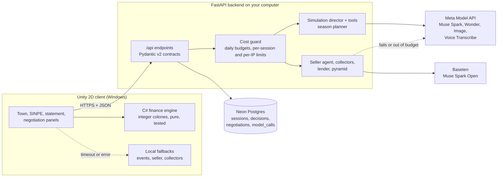

# Architecture

How ColonQuest is put together, what keeps a model from breaking the simulator, and what one run costs.
The decisions behind each part are in [`docs/adr/`](adr/); this page is the map.

## The pieces

| Piece | Where | What it owns |
| --- | --- | --- |
| Finance engine | `unity/Assets/Scripts/Finance/` | Salary with CCSS and income tax, card interest, minimum payment, installments, aguinaldo, informal loans. Every amount is a `long` of colones |
| Simulator client | `unity/Assets/Scripts/` | The town, the panels, the guided run, the local fallbacks and the calls panel (key **L**) |
| API | `server/app/api/` | The contract the client talks to; every request and reply is a Pydantic model |
| Cost guard | `server/app/cost_guard.py` | Estimates each call with the official prices and keeps the daily spend |
| Simulation director | `server/app/game_master/` | The monthly event, its read-only tools, the season planner and the amount limits |
| Characters | `server/app/negotiation/`, `server/app/talks/` | The seller's hidden sheet and agent, and the collectors, lender and pyramid promoter |
| Telemetry | `server/app/db/` | Sessions, decisions, negotiations and every model call, for Class Mode and for this page |

## One event, from request to screen

1. The client sends the month's `PlayerState`, computed by the engine.
2. The cost guard checks the daily budget, the calls of the session (40 at most) and of the client's IP
   (200 a day).
3. The simulation director asks Muse Spark for an event. In the agentic version the model may call tools such
   as `simulate_purchase` or `project_debt`, with at most 5 steps inside 10 seconds; the tools read and
   compute, and never write the user's state.
4. The reply is validated against the `GameEvent` schema. If it does not validate, it is retried once
   and then replaced by one of 48 hand-written events.
5. Every amount is clamped to the range of its event type: an emergency stays between ₡20 000 and
   ₡250 000, an installment between ₡5 000 and ₡80 000 a month (`server/app/game_master/limits.py`).
6. The client waits 8 seconds at most. If nothing valid arrives, it runs a local event.
7. The engine validates the effects again and applies them in whole colones.

The same pattern holds for every model: the model proposes words, the engine and the sheets own the
numbers, and a fallback is always ready. In a talk with the lender or the collectors, the server
rejects any amount or percentage that is not in the sheet the client sent.

## Guardrails

| Risk | Guardrail |
| --- | --- |
| A model invents an amount | Amounts come from the engine or the sheet; the server clamps or rejects the rest |
| A malformed answer | Schema validation, one retry, then a predefined fallback |
| A slow model | Only Muse Spark is on a live path (3 to 4.4 s measured); Wonder runs in the background or behind a loading screen |
| An empty reply | Every call leaves at least 2 000 tokens for reasoning, 3 072 more on Baseten |
| Runaway spend | `DAILY_BUDGET_USD`: at 80% the simulation director moves to Muse Spark, at 100% only fallback events. Baseten has its own `OPEN_WEIGHTS_DAILY_BUDGET_USD` |
| A leaked key | Keys live only in the backend's environment; the client only knows a URL |
| The open-weights provider fails | The characters fall back to the Meta API, and `model_calls` records which provider answered |

## What one run costs

Unit costs measured on 28 and 29 October with the official prices, from the `model_calls` table
([ADR 0004](adr/0004-model-roles.md)). The total is an estimate built from those units for the
three months of the guided run.

| Call | How many in a guided run | Unit cost | Subtotal |
| --- | --- | --- | --- |
| Monthly event, Muse Spark `minimal` | 3 | about $0.004 | $0.012 |
| Season plan, Muse Wonder | 1 | about $0.015 | $0.015 |
| Year-end summary, Muse Wonder | 1 | about $0.008 | $0.008 |
| Seller and other characters, Muse Spark Open on Baseten | about 8 turns | about $0.0025 | $0.020 |
| Voice, Muse Voice Transcribe | about 1 minute of audio | $0.18 an hour | $0.003 |
| Portraits, scenes and endings, Muse Image | pre-generated once | $0.01 an image | $0 per run |
| **Total** | | | **about $0.06** |

About $0.04 of that is Meta credit and about $0.02 is Baseten credit. With a $5 daily budget, the
backend can serve roughly 80 to 120 full runs a day before it falls back to Muse Spark only.

## Further reading

- [ADR 0001: Meta API contracts](adr/0001-meta-api-contracts.md)
- [ADR 0002: open-weights characters](adr/0002-open-weights-npcs.md)
- [ADR 0003: agentic simulation director](adr/0003-agentic-game-master.md)
- [ADR 0004: model roles by measured latency](adr/0004-model-roles.md)
- [Deployment](deployment.md)
