  
  
  
  

  

<b>Read this page as text</b>

# Development workflow

How the DoWhile Team (Keylor Pineda and Jefferson Abarca) built ColonQuest during the hackathon. Every change
went through a Jira ticket, its own branch and a pull request with green CI, so the history shows the work day
by day. The rules for contributors are in [CONTRIBUTING](../CONTRIBUTING.md).

## In numbers

| Figure | What it counts |
| --- | --- |
| 150 | Jira tickets in project `SCRUM`, each with its own branch and pull request |
| 142 | Pull requests merged into `develop`, every one with green CI |
| 790+ | Commits since 26 October 2026, small and named after their ticket |
| v1.0.0+ | Tagged releases on `main`, each with the Windows zip |

## Tools

| Tool | Role |
| --- | --- |
| Jira (project `SCRUM`, [board](https://keylorpineda.atlassian.net/jira/software/projects/SCRUM/boards/1)) | Backlog, sprints, ticket status |
| GitHub | Code, pull requests, CI and releases |
| GitHub for Atlassian | Shows each ticket's branches, commits, pull requests and builds in Jira |

Any branch, commit or pull request that contains a key like `SCRUM-12` shows up in that ticket's
**Development** panel.

## Sprints

Epics SCRUM-5 to SCRUM-17 group the work. The project was submitted on **2 November 2026**.

| Sprint | Dates (2026) | Goal | What we ended with |
| --- | --- | --- | --- |
| Sprint 1: Foundations | 26 to 27 October | Every Meta model answers from the backend; the user walks between stations | Done |
| Sprint 2: Working Month | 28 to 29 October | One full month working end to end | Done, plus the characters on Muse Spark Open in Baseten |
| Sprint 3: Negotiation | 30 to 31 October | Negotiation by voice, with text as a fallback | Done, plus the three agents with tools |
| Sprint 4: Pilot and Submission | 1 to 2 November | README, video and submission | Done: guided simulation, feature demo, submission |
| After the submission | 3 to 4 November | Let the judges run it with their own key | A local backend on SQLite, one launcher and tagged releases |

Decision gates kept the scope honest: the open-weights provider was decided on **28 October**, once the Baseten
credits were approved, and the agents on **29 October**, once the working month was done. If anything had
slipped, the cut order was: agents, open weights, Class Mode, images in real time, voice. The working month and
the text negotiation were never on that list.

## Branches and releases

- `develop` is the integration branch and the default on GitHub. Every pull request lands there.
- Branches come from `develop` and name their ticket: `feat/SCRUM-12-game-master`, `fix/SCRUM-40-negative-cash`.
- Feature pull requests are merged with rebase, so every small commit stays in the history.
- `main` only receives tagged releases from `develop` (`release: vX.Y.Z`) or a `hotfix/*`. Each release carries
  `ColonQuest-Windows.zip`, built with `python scripts/build_game.py`.

## Continuous integration

Two workflows run on every pull request into `develop` or `main`. Branch protection requires both checks and
an up-to-date branch, and pull request runs test the merge commit, so CI validates exactly what will land.

| Required check | Workflow | What it does |
| --- | --- | --- |
| `CI passed` | `.github/workflows/ci.yml` | Gate job over every CI job below |
| `Title and branch reference a Jira ticket` | `.github/workflows/pr-title.yml` | Enforces `type(scope): summary [SCRUM-n]` and the branch rules |

Jobs in `ci.yml`, run in parallel and only when their area changed:

| Job | Runs when | Notes |
| --- | --- | --- |
| Server / lint | `server/` or `shared/` changed | Ruff lint and format check |
| Server / type-check | `server/` or `shared/` changed | `mypy --strict` |
| Server / test | `server/` or `shared/` changed | pytest with coverage; any warning fails the test |
| Engine / NUnit tests | `unity/` changed | The engine's tests outside Unity, with `dotnet test` |
| Unity / EditMode tests | `unity/` changed | Needs the `UNITY_LICENSE`, `UNITY_EMAIL` and `UNITY_PASSWORD` secrets |
| Workflows / actionlint | `.github/workflows/` changed | Lints the workflow files |

Speed techniques:

- Path filtering: unaffected jobs are skipped, and the gate treats them as passed.
- Caching: uv packages and the Python install (`setup-uv`), Ruff and mypy caches, and the Unity `Library` folder.
- `uv sync --frozen` with a committed `uv.lock`: no dependency resolution in CI.
- Superseded runs on the same pull request are cancelled; runs on `main` and `develop` never are.
- Every job has a short timeout, so a hung run cannot block merges.

Locally, `python scripts/run_tests.py` runs only the suites a change can affect, and PlayMode runs there too.

## Definition of done

- Merged into `develop` through a pull request with green CI.
- Tests added for logic (finance engine, validation, cost guard).
- No secrets committed; money handled as whole colones.
- The Jira ticket moved to **Done**.

