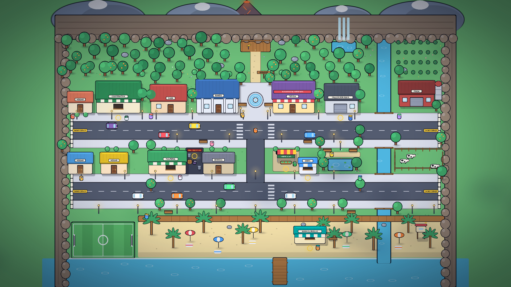
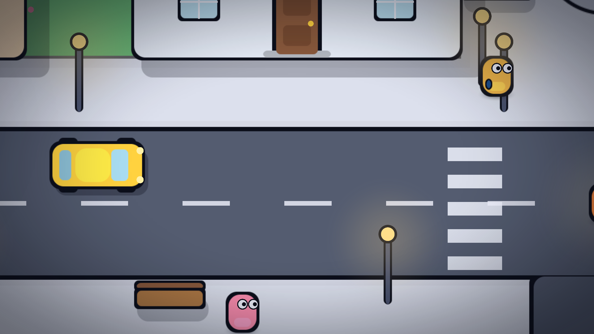
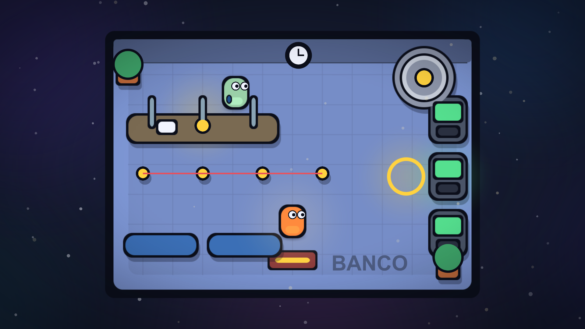

# Colón Quest — Unity client

Unity 2D project (WebGL + desktop). Owner: Jefferson.

## Open the project

1. Install Unity Hub and the editor **6000.3.27f1** (the version pinned in
   `ProjectSettings/ProjectVersion.txt`) with the **WebGL Build Support** module.
2. In Unity Hub choose **Add project from disk** and select this `unity/` folder.
3. Open `Assets/Scenes/Town.unity` and press Play.
4. Commit the `.meta` file that Unity creates next to every new asset.

`unity/Library`, `Temp`, `Logs` and `UserSettings` stay ignored.

## Layout

```
Assets/
  Scripts/
    Finance/     # FinanceEngine: pure C#, no UnityEngine dependency
    Api/         # HTTP client and DTOs mirroring shared/schemas
    UI/          # SINPE, account statement, decision and negotiation panels
    World/       # Player, doors, stations, camera, parallax, Y sorting
  Plugins/WebGL/ # MediaRecorder .jslib for voice capture
  Art/Sprites/   # Generated base shapes (rounded rectangles, circle, ring, soft circle, vignette, square)
  Editor/        # SpriteFactory and the MapBuilder partial files that generate every scene
  Scenes/        # Town, Casa, Tienda and Banco, generated by MapBuilder
  Tests/EditMode/   # Finance engine, API client, movement, camera and Y sorting rules
  Tests/PlayMode/   # Plays the real scenes: collisions, doors, stations, camera and parallax
```

## The world

The game is an open world you walk around, in the spirit of a Pokémon town. The town sits in
the middle: two streets joined by an avenue, a plaza and fountain, and a park with a pond. Around
it the world is about three and a half times larger (92 by 66 units), and every edge is a natural
barrier instead of a hedge:

- North: a forest with a trail up to a lookout, then a rock face with a waterfall, with mountains and a volcano behind it.
- East: a river with two bridges (one per street). Past it, a farm with a barn, a silo, a coffee plantation and a pasture with wandering cows, closed by a cliff.
- West: a neighborhood with the cooperative and houses, and a football field, closed by a cliff.
- South: a boardwalk, a beach with palms and umbrellas, a lifeguard tower, Soda El Muelle and a pier into the sea.
- Both streets end at a "CAMINO CERRADO" barrier. Invisible colliders follow the rocks, the river and the shoreline.

Each place is a kind of money decision the game master can throw at the player.



| Place | How you use it | Event type it feeds |
| --- | --- | --- |
| Casa | Door, then the interior with kitchen, living room, dining table and bedroom | budget, emergency fund |
| Banco | Door, then the interior with the teller counter, three ATMs and the vault | `income` |
| Tienda | Door, then the interior with TVs, appliances, shelves and the vendor | `offer` (the installment trap) |
| Taller de Don Rafa | Station on the sidewalk in front of the garage | `emergency` |
| Pulpería | Station in front of the service window | `expense` |
| Prestamos Rápidos | Station in the dark alley, with the lender | `scam` (gota a gota) |
| Inversiones Seguras | Station at the stand with the "300%" banner | `scam` (pyramid scheme) |
| Kiosco SINPE | Station in front of the booth | `macro_news` |
| Cooperativa de ahorro | Station in front of the counter window, in the west | savings, `offer` |
| Soda El Muelle | Station in front of the beach counter, in the south | `expense` |

Today the stations only fire `PlayerEntered` and `PlayerExited`; the overlay panels that react to
them come with the playable month.

## Playing a run

A run is three months (`GameRules.MonthsToPlay`). Each month has `GameRules.TasksPerMonth` tasks and
ends at the bank. The overlay appears over the town scene and follows the player into the buildings.

| Where | Key | What happens |
| --- | --- | --- |
| Any street place (garage, grocery, lender, stand, kiosk, cooperative, soda, store) | E | Asks the game master for an event and opens it as a window. One task per place and month |
| Event window | 1 to 4 or click | Applies the chosen option through `FinanceEngine.ApplyChoice`, shows what changed, and records the decision in the backend |
| Banco (cashier) | E | Collects the salary and runs the month with `FinanceEngine.RunMonthlyTick`: installments, the card cycle and interest, living expenses |
| Casa | E | The account statement: cash, savings, card, installments, loans and net worth |
| After the last month | | The summary from the backend, or a local one when it is offline, and "Jugar de nuevo" |

The status card in the top left shows the month, the tasks done, cash, savings, the card balance,
the installments per month and well-being. Windows block the player's movement
(`PlayerController.Blocked`).

| File | What it does |
| --- | --- |
| `Scripts/Game/GameRules.cs` | Length of a run, the starting `PlayerState`, debt and net worth helpers, and `Money.Format` (₡85 000) |
| `Scripts/Game/GameLoop.cs` | The rules without Unity: which tasks are done, applying a choice, closing the month |
| `Scripts/Game/GameSession.cs` | Joins the loop with `ApiClient` and raises events for the UI |
| `Scripts/UI/UiKit.cs`, `ModalPanel.cs` | The Among Us style cards, buttons and the single modal window |
| `Scripts/UI/GameUi.cs` | Status card, prompt, loading card and every window |
| `Scripts/UI/GameBootstrap.cs` | Placed in the Town scene; creates the session and the overlay once |

Without a backend the run is fully playable with the local events. To play against the real one:
start it (see `server/README.md`) and keep the default `ApiConfig.LocalUrl`.

## Backend client

`Assets/Scripts/Api/` (assembly `ColonQuest.Api`) is the only code that talks to the FastAPI
backend. It holds no keys: the model keys live on the server.

| File | What it does |
| --- | --- |
| `ApiDtos.cs` | Wire shapes of `shared/schemas`, with the camelCase field names JsonUtility needs |
| `WireEnum.cs` | Closed enums to and from their snake_case names; unknown values in lists are skipped |
| `ApiMapper.cs` | DTOs to the finance engine types (`GameEvent`, `PlayerState`) and back; checks choices and every effect with `EffectLimits` |
| `ApiService.cs` | The calls as coroutines: create session, monthly event, decisions, negotiation text, summary, health |
| `HttpTransport.cs` | `UnityWebRequest` transport with its own timeout watchdog; works in the editor, desktop and WebGL |
| `FallbackEvents.cs` | Local event catalog used when the backend fails |
| `ApiClient.cs` | `MonoBehaviour` that runs the service and survives scene changes: `ApiClient.Instance` |
| `ApiConfig.cs` | Base URL (`http://localhost:8000/api` by default; call `ApiConfig.Use(url)` before the first call) and timeouts |

Rules the client follows:

- Money is `long` colones end to end. Nothing is a `float` except the interest percentages, as in the contract.
- Errors are values (`ApiResult<T>`), never exceptions, so a bad response cannot break the game.
- The monthly event never fails. If the backend is down, takes more than 8 seconds, returns broken JSON, an unknown enum or an effect outside the allowed range, the game plays an event from `Resources/fallback_events.json`. That file is a copy of `server/app/game_master/fallback_events.json` wrapped as `{ "events": [...] }`; a test checks that every event in it is valid.
- Decisions, negotiation and summary report their failure to the caller, which decides what to show. Typed text is the negotiation path that always exists.

```csharp
var client = ApiClient.Instance;
client.CreateSession(null, _ => client.RequestEvent(state, result =>
{
    // result.Value is a valid GameEvent; result.Source says Remote or Fallback.
}));
```

## Controls

Arrow keys or WASD move the player. Diagonal movement is not faster than straight movement.
The project uses Unity's classic Input Manager (`Horizontal` and `Vertical` axes), which works
the same in desktop and WebGL builds. Overlay panels set `PlayerController.InputEnabled = false`
while they are open.

Walking up into a building door fades to its interior; stepping on the red doormat inside fades
back to the street in front of that door (`Door`, `SceneTransition`, `SpawnPoint`). Walls,
buildings, trees, cars and furniture have colliders; decoration lying on furniture does not.
The camera follows the player smoothly and never shows past the edge of the map
(`CameraFollow`, `CameraMath`).

## Art style

The whole game uses an Among Us style cartoon look, not pixel art:

- Flat solid fills with thick dark outlines and rounded corners. No gradients, no pixel filtering.
- Colors come only from `Scripts/World/GamePalette.cs`. Green is money in, red is debt, blue is an alert, yellow marks a station.
- Shapes are white sprites tinted per object, so there are no hand-drawn assets to keep in sync.

What the camera sees while playing, and an interior:





## Depth and lighting

Sorting layers keep each group's draw order apart, back to front:

| Sorting layer | What lives there |
| --- | --- |
| `Background` | In the interiors, nebulae and two star layers (`ParallaxLayer`, factors 0.92, 0.88 and 0.72). Mid stars twinkle. |
| `Floor` | Grass, sidewalks, roads, room floors, shadows, station rings and rugs. |
| `Default` | Buildings, trees, furniture, characters and walls. |
| `Foreground` | In the interiors, dust that moves against the camera. In the town, cloud shadows that drift across it. Then the vignette and the scene fader. |

In the town every object is grouped (`SortingGroup`) and sorted by the height of its feet
(`YSort`), so the player walks in front of a tree when south of it and behind it when north.

Light is faked with soft sprites: a warm glow follows the player, each station has a breathing
glow, street lamps glow, and in the interiors the TV, ATM and desk lamp throw colored pools
(`Flicker`). Characters have a bounce, squash and idle breathing cycle (`PlayerAnimator`), and
pedestrians walk between two points (`Patrol`).

## Rebuilding the scenes

The scenes are generated, not hand-edited. After changing any `Assets/Editor/MapBuilder*.cs`
file run **Colon Quest > Build All Scenes** and commit the changed `.unity` files.

| File | What it builds |
| --- | --- |
| `MapBuilder.cs` | Shared helpers, the camera, sorting layers, stations and spawn points |
| `MapBuilder.Characters.cs` | The player, NPCs with their looks, and pedestrians |
| `MapBuilder.Interiors.cs` | Casa, Tienda and Banco |
| `MapBuilder.Town.cs` | The town layout: streets, lots, buildings, nature, people |
| `MapBuilder.Town.Props.cs` | Buildings, trees, lamps, benches, cars and the fountain |
| `MapBuilder.World.cs` | The open world around the town: sea, river, cliffs, mountains, forest, farm, neighborhood, beach and the invisible borders |

`MapBuilder.RenderPreview` saves a camera view to a PNG for reviews, for example
`-previewScene Town -previewZoom 17.5 -previewAt 0,-1.5`. Use `-previewZoom 33 -previewAt 0,-1` for the whole world.

## Tests

Run them from Window > General > Test Runner. EditMode covers the finance engine and the pure
rules (movement, camera clamping, Y sorting). PlayMode loads each real scene and checks the
walls, furniture, doors, transitions, stations, the world edges (cliffs, sea, river, bridges and pier), camera and parallax.
