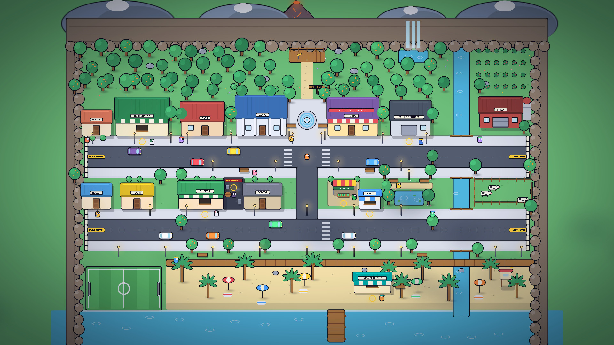
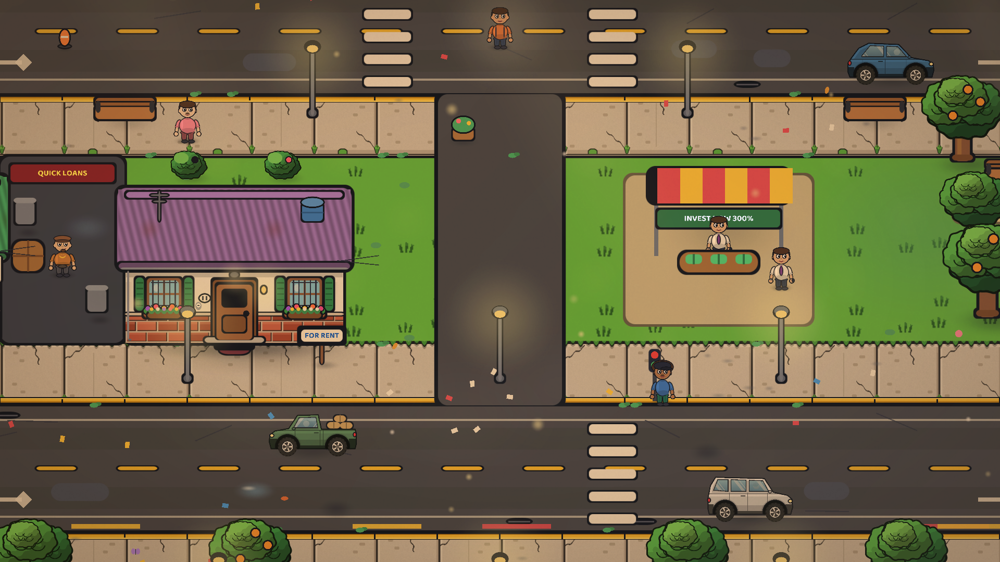
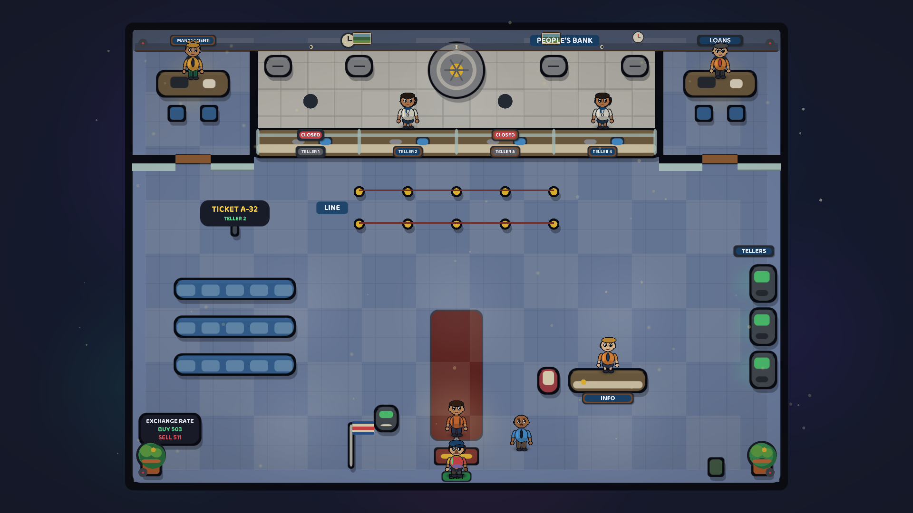

# ColonQuest: Unity client

Unity 2D project for the personal finance simulator. The delivered build is Windows; the WebGL target
still compiles from **ColonQuest > Build > WebGL**. Owner: Jefferson.

To run the simulator or make the executable, follow [`RUN_AND_BUILD.md`](../RUN_AND_BUILD.md). This
file is for working on the Unity project.

## Open the project

1. Install Unity Hub and the editor **6000.3.27f1** (the version pinned in
   `ProjectSettings/ProjectVersion.txt`). Add **WebGL Build Support** only to build for the web.
2. In Unity Hub choose **Add project from disk** and select this `unity/` folder.
3. Open `Assets/Scenes/Menu.unity` and press Play. The first scene of the build is the menu.
4. Commit the `.meta` file that Unity creates next to every new asset.

`unity/Library`, `Temp`, `Logs` and `UserSettings` stay ignored.

## Layout

```
Assets/
  Scripts/
    Finance/     # FinanceEngine: pure C#, no UnityEngine dependency
    Api/         # HTTP client, DTOs mirroring shared/schemas, local events and the local seller
    Game/        # Rules of a run without Unity: loop, clock, bills, career, goals, saves, guided route
    UI/          # Menu, HUD, phone, map, negotiation and talk panels, end screen, feature demo
    World/       # User, doors, stations, traffic, sound, water, Y sorting, translations
    Lighting/    # The 2D sun and the night lights
  Plugins/WebGL/ # MediaRecorder .jslib for voice capture in the browser
  Resources/     # Fonts, menu art and fallback_events.json
  Art/Sprites/   # Generated base shapes (rounded rectangles, circle, ring, soft circle, vignette, square)
  Editor/        # BuildScript, SpriteFactory and the MapBuilder partial files that generate every scene
  Scenes/        # The 15 scenes of the build, generated by MapBuilder
  Tests/EditMode/   # Finance engine, API client and the pure rules of Game and World
  Tests/PlayMode/   # Plays the real scenes: menu, guided run, town, interiors, phone, jail
Tests.DotNet/    # The same finance tests outside Unity, for CI
```

## The world

The simulator is an open world you walk around. The town sits in the middle: streets, a plaza and
fountain, and a park with a pond. Two districts around it double the working area. The camera may
show 118 by 91 units (`MapLayout.TownBounds`), and every edge is a natural barrier:

- North: the forest and the north district, an avenue with the real estate agency, the car agency, the police station, the hospital and a neighborhood. Behind it, a rock face with a waterfall, mountains and a volcano.
- East: a river with three bridges (two streets and the avenue). Past it, the east district with the farm, a pasture and a beach, closed by a rock face.
- West: a neighborhood with the cooperative and houses, and a football field, seen but out of reach.
- South: a boardwalk, a beach with palms and umbrellas, a lifeguard tower, Soda El Muelle and a pier into the sea.
- The walkable area ends at invisible walls inside the world (x from -44.5 to 64, north at y 42); everything past them is scenery the camera still shows, so no edge looks like an edge. More invisible colliders follow the rocks, the river and the shoreline.
- City details: named groups under `Map/City` (road markings and stains, street furniture, facade and roof details, nature, river and beach life, sky), built by `MapBuilder.City.cs`.
- Life: traffic and crossing signals, pedestrians, a dog, boats, seagulls, fish, a day cycle with night lights, and sound made in code (`ProceduralSound`, `AudioDirector`).
- Depth: haze toward the far north, grass, flowers, bushes and rocks sorted by their feet, floating pollen, slanted light beams, leaf shadows, falling leaves, birds and high clouds that each slide at their own speed, plus sun patches, contact shadows, mist, water glints and reeds on the ground (`MapBuilder.Depth.cs`, `MapBuilder.Atmosphere.cs`).

Each place is a kind of money decision. `TownPlaces.All` lists what the map shows.



| Place | Scene or station | What it is for |
| --- | --- | --- |
| Casa de mamá | `Casa` | Home and the account statement |
| Tu cuarto | `Cuarto` | The rented room, its furniture and the wardrobe |
| Soda El Muelle | `Soda` | The job: the time clock and the shifts |
| Banco | `Banco` | Teller, ATMs and closing the month |
| Cooperativa | `Cooperativa` | Savings and `offer` events |
| Finca | `Finca` | Investing in coffee or cattle |
| Tienda | `Tienda` | The seller who hides fees (the installment trap) |
| Agencia de carros | `Agencia` | A car with a down payment and installments |
| Inmobiliaria | `Inmobiliaria` | Rent and mortgage |
| Hospital | `Hospital`, `HospitalArriba` | Health insurance and the hospital bed |
| Comisaría | `Carcel` | The police station and its cells |
| Neighbor's house | `Vecino` | A house you can visit |
| Pulpería | `Station_Grocery` | `expense` events |
| Taller de Don Rafa | `Station_Garage` | `emergency` events |
| Cursos | `Station_Courses` | The courses |
| Prestamos Rápidos | `Station_Lender` | `scam` (gota a gota) |
| Inversiones Seguras | `Station_Pyramid` | `scam` (pyramid scheme) |

## Running a simulation

The main menu (`MainMenu`, `MenuEntries`) offers:

| Entry | What it does |
| --- | --- |
| Guided simulation | Three real months on a short stretch of the town, where only the decisions are left to the user (`GuidedRoute`, `GameUi.Guided.cs`). The clock stops and it never touches saved simulations |
| Story mode | The free run, in one of three save slots (`SaveSlots`) |
| Feature demo | Each feature one click away against the backend, with what the models did on the right (`DemoLab*.cs`). It has its own sessions |
| Settings, Credits, Quit | Quit does not exist in a browser |

The simulator starts in English; Spanish is in Settings. Spanish literals are the keys of
`World/Translations.cs`, so a repeated key breaks it and a new text needs its English line.

A run is three months (`GameRules.MonthsToPlay`; the engine supports 12). A month is four days of
two tasks each (`GameRules.DaysPerMonth`, `TasksPerDay`), a day goes from 6:00 to 22:00, and the
last day closes at the bank. `TaskList` and `Objectives` say what comes next.

| Where | Key | What happens |
| --- | --- | --- |
| A street place | E | Asks the simulation director for an event and opens it as a window |
| Event window | 1 to 4 or click | Applies the chosen option through `FinanceEngine.ApplyChoice`, shows what changed, and records the decision in the backend |
| Tienda | E | Opens the negotiation by voice or text (`NegotiationPanel`) |
| Lender, collectors, pyramid | E | Opens a talk with the model, or the local rules of `DebtTalk` (`TalkPanel`) |
| Banco, last day | E | Runs the month with `FinanceEngine.RunMonthlyTick`: installments, the card cycle and interest, living expenses |
| After the last month | | The summary from the backend, or a local one when it is offline, on the end screen |

Windows block the user's movement (`PlayerController.Blocked`).

| File | What it does |
| --- | --- |
| `Scripts/Game/GameRules.cs` | Length of a run, the clock, the starting `PlayerState`, debt and net worth helpers, and `Money.Format` (₡85 000) |
| `Scripts/Game/GameLoop.cs` | The rules without Unity: which tasks are done, applying a choice, closing the month |
| `Scripts/Game/GameSession.cs` | Joins the loop with `ApiClient` and raises events for the UI |
| `Scripts/UI/UiKit.cs`, `ModalPanel.cs` | The cartoon cards, buttons and the single modal window |
| `Scripts/UI/GameUi*.cs` | The overlay of a run: HUD, prompts, bank, bills, work, market, map and every window |
| `Scripts/UI/PhoneUi*.cs` | The phone: SINPE, bank, bills, goals, search, calculator, a block puzzle and a casino |
| `Scripts/UI/AiCallsPanel.cs` | What the models did in the session, read from `/trace` (key L). It never shows keys |
| `Scripts/UI/GameBootstrap.cs` | Placed in the Town scene; creates the session and the overlay once |

Without a backend the run works with the local events and the local seller. For the real one, start
it with `python scripts/run_local.py` and keep the default `ApiConfig.LocalUrl`. There is no hosted
backend.

## Backend client

`Assets/Scripts/Api/` (assembly `ColonQuest.Api`) is the only code that talks to the FastAPI
backend. It holds no keys: the model keys live on the server.

| File | What it does |
| --- | --- |
| `ApiDtos.cs` | Wire shapes of `shared/schemas`, with the camelCase field names JsonUtility needs |
| `WireEnum.cs` | Closed enums to and from their snake_case names; unknown values in lists are skipped |
| `ApiMapper.cs` | DTOs to the finance engine types (`GameEvent`, `PlayerState`) and back; checks choices and every effect with `EffectLimits` |
| `ApiService.cs` | The calls as coroutines: session, monthly event, decisions, negotiation, talks, images, summary, trace, health |
| `HttpTransport.cs` | `UnityWebRequest` transport with its own timeout watchdog; works in the editor, desktop and WebGL |
| `MultipartForm.cs` | The form that carries a voice clip to the backend |
| `FallbackEvents.cs` | Local event catalog used when the backend fails |
| `LocalSeller.cs`, `SellerOffer.cs` | The seller when the backend cannot answer, and the figures of the offer |
| `ApiClient.cs` | `MonoBehaviour` that runs the service and survives scene changes: `ApiClient.Instance` |
| `ApiConfig.cs` | Base URL and timeouts. The editor uses `http://localhost:8000/api`; a build reads `COLONQUEST_API_URL`, then `colonquest.env` beside the exe, and otherwise uses that same address |

Rules the client follows:

- Money is `long` colones end to end. Nothing is a `float` except the interest percentages, as in the contract.
- Errors are values (`ApiResult<T>`), never exceptions, so a bad response cannot break the simulator.
- The monthly event never fails. If the backend is down, takes more than 8 seconds, returns broken JSON, an unknown enum or an effect outside the allowed range, the simulator runs an event from `Resources/fallback_events.json`. That file is a copy of `server/app/game_master/fallback_events.json` wrapped as `{ "events": [...] }`; a test checks that every event in it is valid.
- Decisions, negotiation and summary report their failure to the caller, which decides what to show. Typed text is the negotiation path that always exists.

```csharp
var client = ApiClient.Instance;
client.CreateSession(null, _ => client.RequestEvent(state, result =>
{
    // result.Value is a valid GameEvent; result.Source says Remote or Fallback.
}));
```

## Controls

| Key | What it does |
| --- | --- |
| Arrows or WASD | Walk. Diagonal movement is not faster than straight movement |
| E | Use the place in front of you |
| 1 to 4 | Choose an option in a window |
| P | Phone |
| M | Town map |
| Tab | Show or hide the task list |
| H | Show or hide the HUD |
| L | What the models did |
| Esc | Pause |
| F11 or Alt+Enter | Full screen |

The project uses Unity's classic Input Manager (`Horizontal` and `Vertical` axes), which works the
same in desktop and WebGL builds. Overlay panels set `PlayerController.InputEnabled = false` while
they are open.

The first interiors are big: the Casa is 16.5 by 12, the Tienda 18 by 12.6 and the Banco 24 by 16.8.
The sizes of all of them are in `MapLayout`. The `MapBuilder.Interiors.*.cs` files fill them with
named detail groups.

Walking up into a building door fades to its interior; stepping on the red doormat inside fades
back to the street in front of that door (`Door`, `SceneTransition`, `SpawnPoint`). Walls,
buildings, trees, cars and furniture have colliders; decoration lying on furniture does not.
The camera follows the user smoothly and never shows past the edge of the map
(`CameraFollow`, `CameraMath`).

## Art style

The whole simulation uses an Among Us style cartoon look, not pixel art:

- Flat solid fills with thick dark outlines and rounded corners. No gradients, no pixel filtering.
- Colors come only from `Scripts/World/GamePalette.cs`. Green is money in, red is debt, blue is an alert, yellow marks a station.
- Shapes are white sprites tinted per object, so there are no hand-drawn assets to keep in sync.

What the camera saw during a run on 27 October, and an interior:





## Depth and lighting

Sorting layers keep each group's draw order apart, back to front:

| Sorting layer | What lives there |
| --- | --- |
| `Background` | In the interiors, nebulae and two star layers (`ParallaxLayer`, factors 0.92, 0.88 and 0.72). Mid stars twinkle. |
| `Floor` | Grass, sidewalks, roads, room floors, shadows, station rings and rugs. |
| `Default` | Buildings, trees, furniture, characters and walls. |
| `Foreground` | In the interiors, dust that moves against the camera. In the town, cloud shadows that drift across it. Then the vignette and the scene fader. |

In the town every object is grouped (`SortingGroup`) and sorted by the height of its feet
(`YSort`), so the user walks in front of a tree when south of it and behind it when north.

Light is faked with soft sprites: a warm glow follows the user, each station has a breathing
glow, street lamps glow, and in the interiors the TV, ATM and desk lamp throw colored pools
(`Flicker`). Characters have a bounce, squash and idle breathing cycle (`PlayerAnimator`), and
pedestrians walk between two points (`Patrol`).

## Rebuilding the scenes

The scenes are generated, not hand-edited. After changing any `Assets/Editor/MapBuilder*.cs`
file run **ColonQuest > Build All Scenes** and commit the changed `.unity` files.

| File | What it builds |
| --- | --- |
| `MapBuilder.cs` | Shared helpers, the camera, sorting layers, stations and spawn points |
| `MapBuilder.Menu.cs` | The menu scene |
| `MapBuilder.Characters.cs`, `.Cast.cs`, `.People.cs`, `.Dog.cs` | The user, NPCs with their looks, pedestrians and the dog |
| `MapBuilder.Interiors*.cs` | Every interior, one file per place or family of places |
| `MapBuilder.Town.cs`, `.Town.Props.cs` | The town layout, its buildings, trees, lamps, benches and the fountain |
| `MapBuilder.Districts.cs`, `.Districts.Props.cs` | The north and east districts |
| `MapBuilder.World.cs` | The open world around the town: sea, river, cliffs, mountains, forest, beach and the invisible borders |
| `MapBuilder.City.cs`, `.Crossings.cs`, `.Cars.cs`, `.Things.cs`, `.Realism.cs` | City details, crossings, cars and things to use |
| `MapBuilder.Depth.cs`, `.Atmosphere.cs`, `.Lighting.cs` | Depth layers, atmosphere and the 2D lights |

`MapBuilder.RenderPreview` saves a camera view to a PNG for reviews, for example
`-previewScene Town -previewZoom 17.5 -previewAt 0,-1.5`. Use `-previewZoom 33 -previewAt 0,-1` for the whole world.

## Tests

Run them from Window > General > Test Runner, or with `python scripts/run_tests.py` from the root,
which picks the suites a change can affect. EditMode covers the finance engine, the API client and
the pure rules. PlayMode loads the real scenes and checks the menu, the guided run, walls, furniture,
doors, transitions, stations, the world edges, the phone and the jail.

The finance tests also run without Unity, as CI does:

```bash
dotnet test unity/Tests.DotNet/ColonQuest.Finance.Tests.csproj
```
