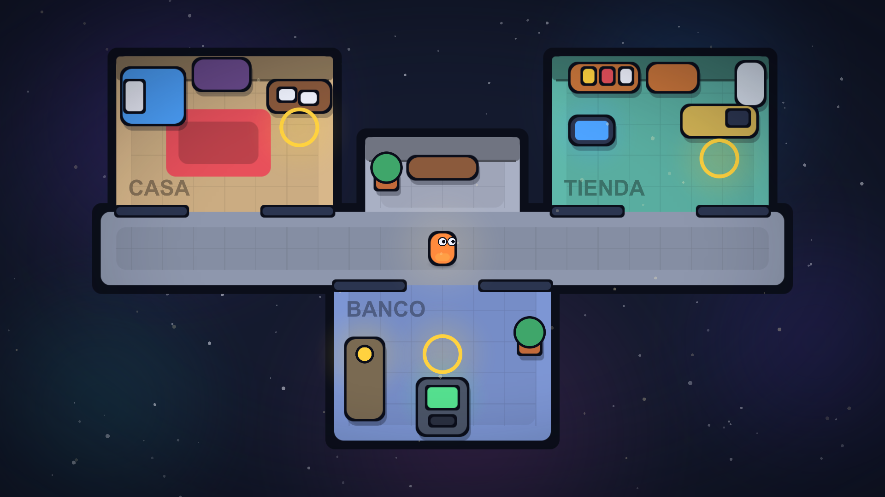
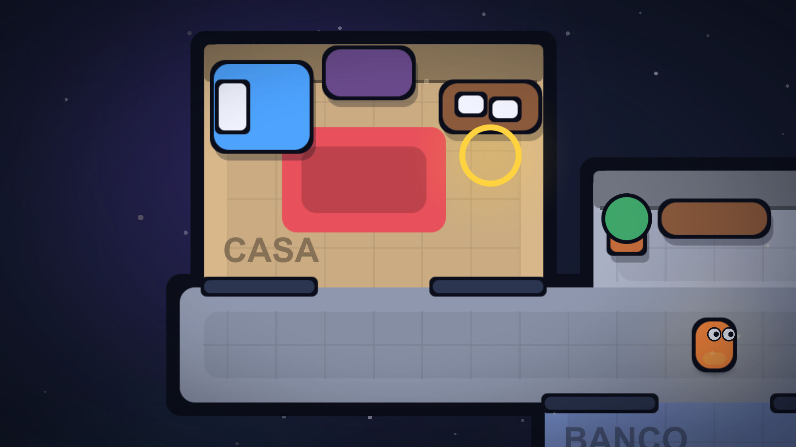

# Colón Quest — Unity client

Unity 2D project (WebGL + desktop). Owner: Jefferson.

## Open the project

1. Install Unity Hub and the editor **6000.3.27f1** (the version pinned in
   `ProjectSettings/ProjectVersion.txt`) with the **WebGL Build Support** module.
2. In Unity Hub choose **Add project from disk** and select this `unity/` folder.
3. Commit the `.meta` file that Unity creates next to every new asset.

`unity/Library`, `Temp`, `Logs` and `UserSettings` stay ignored.

## Layout

```
Assets/
  Scripts/
    Finance/     # FinanceEngine: pure C#, no UnityEngine dependency
    Api/         # HTTP client and DTOs mirroring shared/schemas
    UI/          # SINPE, account statement, decision and negotiation panels
    World/       # Player movement, stations, map
  Plugins/WebGL/ # MediaRecorder .jslib for voice capture
  Art/Sprites/   # Generated base shapes (rounded rectangles, circle, ring, soft circle, vignette, square)
  Editor/        # SpriteFactory and MapBuilder editor tools
  Scenes/        # Main.unity, generated by MapBuilder
  Tests/EditMode/   # Finance engine, movement and camera rules
  Tests/PlayMode/   # Plays Main.unity: walls, furniture, stations, camera and parallax
```

## Controls

Arrow keys or WASD move the player. Diagonal movement is not faster than straight movement.
The project uses Unity's classic Input Manager (`Horizontal` and `Vertical` axes), which works
the same in desktop and WebGL builds. Overlay panels set `PlayerController.InputEnabled = false`
while they are open.

Walls and furniture have colliders; decoration lying on furniture does not. The camera follows
the player smoothly and never shows past the edge of the map (`CameraFollow`, `CameraMath`).

## Art style

The whole game uses an Among Us style cartoon look, not pixel art:

- Flat solid fills with thick dark outlines and rounded corners. No gradients, no pixel filtering.
- Colors come only from `Scripts/World/GamePalette.cs`. Green is money in, red is debt, blue is an alert, yellow marks a station.
- Shapes are white sprites tinted per object, so there are no hand-drawn assets to keep in sync.



What the camera sees while playing:



## Depth and lighting

The scene is built in layers, back to front. Sorting layers keep each group's draw order apart:

| Sorting layer | What lives there |
| --- | --- |
| `Background` | Nebulae and two star layers. `ParallaxLayer` moves them by a fraction of the camera (0.92, 0.88 and 0.72) so they read as far away. Mid stars twinkle. |
| `Floor` | Room outlines, floors, plates, tile joints, back wall faces and the rug. |
| `Default` | Soft drop shadows, furniture, doorway walls, stations, labels and the player. |
| `Foreground` | Dust that drifts upward and moves against the camera (factor -0.25), then the vignette. |

Light is faked with soft sprites: a warm glow follows the player, each station has a breathing
glow, and the TV, ATM and desk lamp throw colored pools on the floor (`Flicker`). The player has
a bounce, squash and idle breathing cycle (`PlayerAnimator`).

## Rebuilding the map

The map scene is generated, not hand-edited. After changing `Assets/Editor/MapBuilder.cs`
run **Colon Quest > Build Map Scene** and commit `Assets/Scenes/Main.unity`. Each room has a
`Station` trigger (Casa, Tienda, Cajero) that fires events when the player, tagged `Player`,
walks in.
